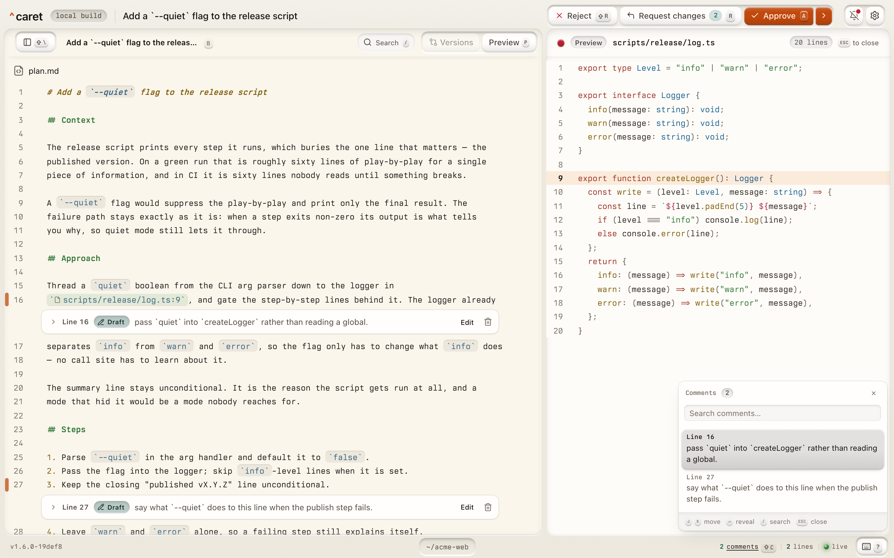

# 🥕 `caret`

`caret` works with your agent host: Claude Code, OpenCode, or pi. It replaces the host's
plan-approval prompt with a review page in your browser. When the agent presents a plan,
you read it there, comment on the lines that matter, then approve it or request changes.
caret sends your feedback back to the agent.

One background service serves every session, so you review several plans from one browser
tab.

<picture>
  <source media="(prefers-color-scheme: dark)" srcset="docs/assets/caret-review-ui-dark.png">
  
</picture>

## Install

It needs [`bun`](https://bun.sh) on your PATH, and macOS or Linux.

```sh
bunx --no-cache @macintacos/caret@latest install
```

Then follow the [tutorial](https://macintacos.github.io/caret/tutorial/first-plan/) to
review your first plan. The [docs site](https://macintacos.github.io/caret/) covers every
agent host, updating, and removing caret.

Want to develop `caret` rather than use it? Start with [CONTRIBUTING.md](CONTRIBUTING.md).

## License

MIT — see [LICENSE](LICENSE). Vendored third-party code and assets are itemized, with
their licenses, in [THIRD_PARTY_LICENSES.md](THIRD_PARTY_LICENSES.md).
