# Plan Render Rules

*Audience: coding agents and contributors changing how a plan is rendered —
`ui/src/lib/diffview/`, the `SourceView` / `DiffPlanView` components, and the preview
renderer `ui/src/lib/planMarkdown.ts`, its mount `ui/src/components/PlanPreview.svelte`,
and the source/preview surface table `ui/src/lib/planView.ts`.*

The **source view** renders a plan as **line-numbered markdown source**. Every decoration
the reviewer sees is drawn over the characters they would copy. Everything up to § The
preview renderer is the contract the whole `ui/src/lib/diffview/` layer shares; each
module's own header carries only what is local to it. The preview is a second surface
rendered from the same stored text, not an exception to transform-in-place. The reader
switches between the two with the plan view's **Preview** toggle; compare mode always
shows source.

## Transform in place (EXC-855)

**Markers stay in the text and are marked, not removed.** Emphasis markers, backticks,
task brackets, quote markers and list bullets are all still there in the DOM; the sheet
overdraws them. That is what keeps the row's gutter number, its hover comment affordance
and its cursor reachability intact, and what makes copy, `/` search, vim motions and
comment anchors all resolve against the same column space.

Three constructs are allowed out of it, and no more:

- **Link collapse** (`links.ts`) — `[label](target)` collapses to `label` and `<url>` to
  `url`. This is the only display rewrite in the layer, and therefore the only reason a
  display column ever differs from a source column.
- **Tables** (`tables.ts`) — the one construct that **restructures** rather than
  overdrawing, because a row's `|` columns do not line up with the table's columns and
  alignment has to come from layout. No character is added, removed or moved.
- **Images** (`inlineImages.ts`) — the picture is **added** to the row, never substituted
  for it. The literal `` stays, so copy carries the real markdown.

Reaching for a fourth exception means changing this file first.

## The pipeline

```graphviz
digraph plan_render {
    rankdir=LR;
    "plan text" [shape=note];
    "links.ts" [shape=box];
    "inlineSpans.ts" [shape=box];
    "inlineDecorate.ts" [shape=box];
    "coreStyles.ts" [shape=box];

    "plan text" -> "links.ts" [label="per line"];
    "links.ts" -> "inlineSpans.ts" [label="display text"];
    "inlineSpans.ts" -> "inlineDecorate.ts" [label="flat runs"];
    "inlineDecorate.ts" -> "coreStyles.ts" [label="tagged tokens"];
}
```

- **`links.ts`** collapses links one line at a time — the only rewrite of plan text. It
  returns display text plus five layers keyed by display line: clickable link spans, file
  references, flat inline runs, blockquote depth, and images. The runs and the depth come
  from handing every display line to `inlineSpans.ts` at once.
- **`inlineSpans.ts`** lexes inline markup a paragraph at a time and emits the flat atomic
  runs per display line — one span per element-bounded stretch of identical attribute set.
  Runs are **flat by requirement**, not by style: a nested wrapper would break the token
  partition below. Abutting elements are never fused, because that boundary is where a
  pill's rounded end gets drawn. A run cut from an element that crosses a line break names
  the members that do (`continues` / `continued`), so no cap is drawn there.
- **`inlineDecorate.ts`** refines shiki's tokens until none straddles a run boundary, then
  tags each with the run covering it.
- **`coreStyles.ts`** turns each attribute into one CSS rule. The ink and chip vocabulary
  it draws from is `svelte-rules.md`'s, not this file's.

The block classifiers — `codeBlocks.ts`, `tables.ts`, `thematicBreaks.ts`, `headings.ts` —
and the reference scanner `fileRefs.ts` run alongside, each answering "which lines are
this construct" and tagging the rows the library painted. Their DOM tagging lives in the
module rather than the component so it is unit-testable against a constructed fixture.

## Line parity

**The output always has the same line count as the input.** Lines are rejoined with `\n`,
and no pass drops or adds one. The annotation and feedback line numbers depend on it: a
pass that dropped or added a line would silently move every comment anchor below it.

**Recognition is a separate question from parity.** The line-leading markers — `>`, list
bullets, task brackets — are read one line at a time, because they only ever start a line.
The link collapse is too, so a link whose label wraps stays literal. Inline grammar is
block-scoped: `inlineSpans.ts` lexes a multi-line paragraph as one text, so a bold, italic
or code span the 90-column reflow broke still pairs, and every line it touches gets a run
clipped to that line. Headings, tables and every other block keep the one-line lex.

**A hard wrap and a soft wrap are different problems.** A hard wrap is a newline in the
source, so the span spans rows and pairing it is the lex's job. A soft wrap is one row the
browser fragments — a long table cell wrapping inside its column — and needs nothing from
the lex; what it can need is CSS that paints per fragment.

## Display coordinates

**Every layer indexes the display text** — the space the reader actually sees — and line
numbers are 1-based, matching the view's per-line `data-line`. Because `links.ts` is the
only pass that rewrites, it is also the only pass that has to think about the
display/source divergence; everything downstream reads display columns and needs no
remapping of its own.

## The token partition

`rowTokens.ts` owns what "a row's tokens" means, and both halves of it are load-bearing:

- **`splitTokens` only ever refines.** Every boundary shiki drew survives a split, so
  every column a later pass looks for is still a token boundary.
- **`tokenChildren` is how a row's tokens are reached** — the row's own children, or a
  table row's cells' children one level down. It exists so no pass has to know which kind
  of row it is looking at.

Every pass locates a token by walking that sequence and accumulating text length.
**No pass may introduce a nested wrapper**: it would break the partition and put an
attribute on an element spanning more than the thing it names.

## Idempotency is a hard requirement

`SourceView.svelte` drives these passes from `MutationObserver`s, so a pass that redoes
settled work loops the observer forever. The two observers have different rules and the
difference matters:

- **The repaint observer** watches `childList` over the whole subtree. Node creation and
  splitting are therefore conditional — an already-correct row is left completely
  untouched. **Attribute writes are free**, because attributes are not observed.
- **The selection observer** watches `attributeFilter: ["data-selected-line"]`. Here a
  write of an *unchanged* value still emits a MutationRecord, so `cardSelection.ts` must
  never write a value that is already there.

Library-owned rows are rewritten on every repaint, so a pass that tags them is also
replayed from the repaint pass, against a non-reactive mirror.

## marked is the grammar of record

The inline and block grammars come from `marked`, already a UI dependency. Reuse its lexer
rather than hand-rolling a scanner: it is what makes nested emphasis, emphasis inside link
labels, escaped markers, setext underlines spelled `---`, table delimiter rows, fenced
`---`, and a break interrupting a list all come out right. A hand-rolled equivalent would
be the fiddliest parser in the repo for a strictly worse answer.

**Where caret's own fence scan and marked disagree, the panel wins.** `codeBlocks.ts`
toggles on every line of three or more backticks, which CommonMark does not, so on a plan
quoting nested fences the two disagree about which rows are code. marked is right, but the
panel is what the reader sees — a rule drawn inside one would read as a bug. Classifiers
take the fenced ranges as a parameter for exactly this reason.

## Safety

`links.ts` owns the scheme gate and it is absolute: only an `http`/`https` target is ever
emitted as clickable or drawable, and no downstream module re-decides safety. A
path-shaped target collapses but records **no** clickable span — `openUrl` must never be
handed a filesystem path. Every other scheme (`javascript:`, `data:`, `mailto:`, the
protocol-relative `//host/…` form, a scheme-less host) stays literal source text, so the
reader can see what the link would actually do. The preview renderer passes every link and
image through the same gate, `isSafeUrl`.

Rendering an image makes the reviewer's browser fetch an arbitrary host when the row
scrolls into view. `referrerpolicy` and `loading` reduce what leaks; they do not close the
channel. Closing it wants an `img-src` CSP on the daemon's own response, which does not
exist today.

## The preview renderer

`renderPlanMarkdown` turns a version's stored text into a `RenderedPlan`: `html` plus one
`SourceSpan` per block.

- **Blocks.** A block is a top-level marked token that renders to something. Each is
  wrapped in a `div` carrying `data-source-start` / `data-source-end`: 1-based, inclusive,
  over the stored text comment anchors use. Blocks are flat siblings; `blocks[i]` is the
  i-th. A block ends at its last non-blank line.
- **Soft breaks** stay `\n` and render as a space.
- **Sanitizing.** Only raw-HTML tokens pass through js-xss, using `htmlWhiteList()`
  (shared with comment bodies) minus every tag that may keep a URL-bearing attribute
  (`href`, `src`, `srcset`, `poster`), plus `div` and `table`, whose unclosed forms would
  swallow later blocks. Those render as text, so the preview fetches and navigates nothing
  the source view would not. caret's own markup and attributes never pass through the
  sanitizer.
- **Links** that pass `isSafeUrl` open in a new tab with `rel="noopener noreferrer"`;
  anything else renders as its label.
- **Images** that pass `isSafeUrl` carry `IMAGE_ATTRIBUTES`, never `srcset`, `style` or
  `title`; anything else renders as its alt text.
- **`[/]`** renders as `data-task="slashed"`. `indeterminate` has no attribute form, so
  `PlanPreview.svelte` sets the property on each such input after every mount of new HTML.

### Source-line map

The preview reflows text, so a rendered position is not a source line. `planSourceMap.ts`
maps between the two for comments, the cursor and search.

- **Markers.** The renderer puts an empty `` before the first
  rendered character of every source line that produces inline text: at the start of each
  leaf (paragraph, heading, list item text, table cell), after every `\n` inside inline
  text — a trailing one included, so a link, codespan or inline tag that opens a line
  counts on that line — and after any other inline token whose raw spans lines. A code
  block gets one marker before its `<pre>`, at its first code line, carrying
  `data-source-code`; an empty code block gets none. A raw-HTML block that renders
  anything gets one at its first line; one the sanitizer empties, such as an HTML comment,
  gets no marker and no block. Markers are inline elements: never wrappers, never inside a
  `<pre>`. Plan text cannot forge one, since the sanitizer allows no attributes on `span`.
- **The map.** `createPlanSourceMap(root)` takes the element whose content is exactly the
  rendered HTML and walks it once per version, storing runs of text offset → line. After a
  `data-source-code` marker, each `\n` in the next element's text that more code follows
  starts the next line's run. No lookup reads layout.
- **Lookups.** `lineAt` gives the line of the character at a DOM point, the last
  character's at the end of the text, and null outside the root or for an empty preview.
  `linesOf` gives the lines of a range's first and last non-whitespace characters (its
  first and last characters when it covers only whitespace), so a triple-click selection
  that ends at the next block's start reports the previous block's line. `rangeOf` gives
  the rendered text a line produced, or null for a line that produced none: blank outside
  code, link definition, fence, table delimiter row, `hr`, out of range.
- **Edges.**
  - A soft break's `\n` belongs to the line it ends.
  - The structural `\n` marked emits between tags belongs to the preceding run (before the
    first run, to the first). `lineAt` at a boundary ahead of one, such as `(tr, 0)`,
    reports the preceding line; `linesOf` skips whitespace and does not.
  - An image is atomic: a safe one renders no text, an unsafe one renders its alt with no
    marker inside. A codespan or image alt that straddles a break maps wholly to its first
    line, and the text after it starts on the right line.
  - An entity such as `&#10;` renders a `\n` but starts no line; markers come from source
    raws, not rendered text.
  - A raw-HTML block's text, a `<pre>` inside it included, maps to its first line.
  - Accepted: a line inside a leaf whose only content renders no text (a link's closing
    `](…)`, a lone inline `</b>` or ` `) still starts a run; with nothing after it in
    the block, the run holds only the structural whitespace, which `rangeOf` returns and
    `lineAt` reports as that line.
- **Highlighting.** Offsets resolve against the live text, so replacing a code block's
  markup, even its whole `<pre>`, with spans of the same text leaves the map valid,
  whether it was built before or after.

## Surfaces

`SURFACE_BEHAVIORS` in `ui/src/lib/planView.ts` is the one place a source-view behavior
declares the surfaces it runs on: `source`, `preview`, or `compare`. `DiffPlanView` gates
each behavior through `runsOn`.

The gates exist because `SourceView` hands `DiffPlanView` an `api` and its `host`, and
nothing clears them when `SourceView` unmounts. An effect, shortcut, or surface outside
`SourceView`'s branch that reads them keeps acting on a detached shadow root unless it
gates through `runsOn`. So a row covers each effect, shortcut `enabled` guard, and
control-row or lane surface in `DiffPlanView` outside that branch. Anything inside the
branch unmounts with it and needs no gate.

Adding `"preview"` to a row switches on the source implementation, which still reads the
stale `api` and `host`. A port gives the behavior a preview implementation first, then
adds `"preview"` to its row.

The preview renders a version once. `memoLast` returns the last result for the same text,
so a toggle flip or a same-version poll tick reuses it. The 2s poll re-delivers the same
version every tick; without the memo each tick would re-lex and re-sanitize the whole
plan.

### Keeping the place across a flip

A flip between source and preview keeps the reader's place, block by block. Both surfaces
read and park at the source view's reading zone and parking offset, so the block one flip
parks is the block the next flip reads back. `ui/src/lib/planPlace.ts` holds the logic;
`setPlanView` captures the place before it swaps the surface.

- **Source to preview.** The source view's top visible line goes through
  `blockIndexForLine` over `RenderedPlan.blocks`. It is a binary search over the block
  spans and measures nothing; the result indexes the preview's children.
- **Preview to source.** `previewTopLine` binary-searches the preview's children for the
  first block whose bottom passes the reading zone, then returns that block's first source
  line. A linear scan would read layout from every block above the fold, which a long plan
  makes slow. `onSourceReady` parks the source row for that line once the new `SourceView`
  mounts.
- **The landing is instant.** A flip swaps the view rather than travelling, so a smooth
  scroll would slide through unrelated text.
- **`holdPlace` re-parks** the target on every resize of the new surface's content, as
  images load and rows highlight. It releases on the reader's first wheel, touch, pointer,
  or key input, when the target is gone, or on the next flip. It ignores `scroll` events,
  since native scroll anchoring moves `scrollTop` too. Each park writes an absolute
  `scrollTop`, never a delta, so it composes with native `overflow-anchor` where a browser
  has it and still holds in Safari 26 and earlier, which has none.
- **A deep link wins.** A resolved `?heading=` jumps on the first source mount, ahead of a
  place carried from the preview, since the preview cannot honor it.

Place-keeping is not a `SURFACE_BEHAVIORS` row. It runs at the flip itself, not on a
surface.
