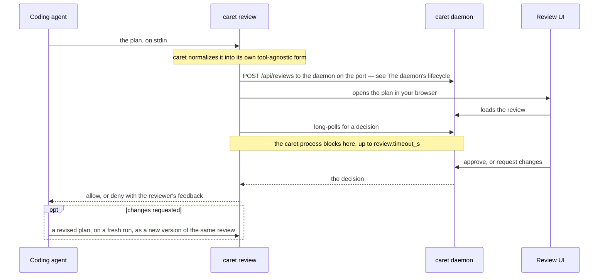

# caret — Architecture

*Audience: users and contributors who want caret's internals — the core/adapter boundary,
the agent adapters, the review tool, and the source layout.*

Part of the deep reference behind [README.md](../README.md). For what caret is, how to
install it, and basic usage, start there.

## How it works

The user-level round trip is on [How caret works](explanation/how-caret-works.md); the
diagram below is the wire-level view.



Your agent reaches caret through `bin/caret`, a small entrypoint shim that runs caret's
subcommands: Claude Code fires it as a hook, OpenCode's plugin spawns it from a tool. The
shim execs the platform-native compiled binary (`bin/caret-native`) when a
`mise run build` produced one, and otherwise runs the `bun` bundle (`dist/cli.js`) that
the marketplace and npm installs ship.

### The daemon's lifecycle

A daemon the service (a launchd agent on macOS, a systemd user unit on Linux) or
`caret serve` started is **resident**, and the service's is **supervised**; one a hook
spawned is **on-demand** and exits after `daemon.idle_ms` with no pending review, no open
long-poll, and no live UI tab. [The background service](explanation/background-service.md)
covers what each means for a user.

The service never names a caret build. Its unit runs the launcher, `bin/caret-launcher`,
copied to `$XDG_STATE_HOME/caret/bin/caret`, which picks caret each time it starts: the
checkout a `--from-local` install pinned, else the highest-versioned caret across the
Claude Code plugin cache, the OpenCode package cache, pi's npm folder, and caret's own
copies under `$XDG_STATE_HOME/caret/roots/` (an agent's root wins a tie). Nothing in the
unit depends on the version.

Every review and prewarm hook first makes sure a current daemon holds the port
(`ensureDaemon`, `src/daemon/lifecycle.ts`):

- A daemon of the hook's own build is reused.
- A daemon of another build that `/api/health` reports as `supervised` belongs to the
  service. When the install that registered that service shares the hook's state
  directory, the hook restarts the service and waits for a daemon with a new `instanceId`,
  since retiring it would only race the supervisor. It leaves the daemon alone when that
  daemon is newer than the hook or the launcher is pinned.
- Any other stale daemon gets `POST /api/retire`, and the hook spawns its own. That covers
  an on-demand daemon, `caret serve`, and a supervised daemon whose service another state
  directory registered.
- When the lock places this state directory's daemon on an address other than the
  configured one — a `daemon.host` or `daemon.port` edit it predates — a takeover hook
  restarts the service for a supervised daemon and retires any other before spawning, so
  the old daemon does not stay up beside the new one. A hook reattaching mid-review
  follows the lock to it instead.
- When nothing holds the port but the service will start a daemon, the hook leaves it to
  the supervisor for `SUPERVISOR_WINDOW_MS` before spawning one.
- A hook that finds another daemon of its state directory still booting, by the
  `daemon.boot` marker there, waits for it rather than spawning a second. The daemon drops
  the marker once its lock is written; a marker whose pid is dead, or older than 30 s, is
  cleared.
- A review hook whose long-poll drops mid-review only reattaches, to whatever daemon of
  its state directory answers, whatever its build.
- When `daemon.host` is not an address on the hook's machine (an `isAddrNotAvail` bind
  probe), the hook only attaches to the daemon there, whatever its build or state
  directory. It never retires, cycles or spawns one, and a hook a draining daemon refused
  still waits for its successor. Nothing answering there denies the review. Every bullet
  above assumes the daemon runs on the hook's machine.

A daemon steps down by draining, on `POST /api/retire` or SIGTERM, which is how a
supervisor stops it. It answers new reviews with `503`, lets in-flight writes land and
unread decisions reach their hooks, then releases the port and exits 0, within
`DRAIN_DEADLINE_MS` (5 s, `src/daemon/server.ts`). A hook refused with that `503` posts
once more, to the successor. SIGINT stops the daemon at once. Idle exit and drain both
live in `src/daemon/liveness.ts`.

A resident daemon never gets the fresh start a respawn would give it, so an hourly upkeep
tick (`src/daemon/upkeep.ts`) does that work instead:

- `update-check` re-runs the update check, which its 24-hour stamp still keeps to about
  once a day.
- `review-sweep` drops reviews unchanged for a week from memory. A starting daemon's
  reload of unresolved reviews from disk skips those too.
- `stderr-rotate` rotates `logs/daemon-stderr.log`, for a supervised daemon only.

### Architecture: tool-agnostic core + agent adapter

caret is built around one boundary. A **tool-agnostic core** (everything in `src/`) owns
the daemon, the on-disk review store, the review/revision lifecycle, the settings service,
leveled logging, and the browser UI — none of it knows which coding agent is on the other
end. An **agent adapter** (`src/adapters/`) owns everything agent-specific: parsing the
agent's hook input, emitting the agent's decision response, declaring the approve variants
it offers, and probing the agent's local install for diagnostics. The core hands the
adapter raw hook stdin and a core decision; the adapter hands back a normalized plan and a
tool-specific stdout response. The dependency runs one way — an adapter imports core
types, never the reverse.

caret registers four adapters today. Claude's is the reference implementation the others
are measured against. Pick one with `CARET_AGENT`; with no selector caret uses Claude, so
the shipped Claude plugin keeps working unchanged.

| Adapter | `CARET_AGENT` | How it wires in | What ships | Status |
| ------- | ------------- | --------------- | ---------- | ------ |
| **Claude Code** — `src/adapters/claude/` | `claude` (the default) | Five hooks; the `PermissionRequest`/`ExitPlanMode` one intercepts the plan. The plugin also serves a `review_plan` MCP tool (`caret mcp`) | The `caret@caret` plugin, from caret's own marketplace | Stable (default) |
| **OpenCode** — `src/adapters/opencode/` | `opencode` | An in-process plugin registering a `caret_review_plan` tool — OpenCode has no plan hook to intercept | The `@macintacos/caret` npm package, plus its own installer | Stable |
| **Codex CLI** — `src/adapters/codex/` | `codex` | A `PermissionRequest` hook | Nothing — no installer, no hook manifests | Provisional, default-off |
| **pi** — `src/adapters/pi/` | `pi` | An extension bridging to `caret review` over the caret-owned envelope | The `@macintacos/caret` npm package's `pi` manifest (`pi install`); `caret install`'s pi target runs `pi install`/`pi update`/`pi remove` | Provisional, default-off |

> [!WARNING]
> The Codex adapter's wire contract is modeled from Codex documentation and has never been
> verified against a live Codex session. It is there to prove the boundary is real, not to
> be relied on.

One more id, `claude-mcp`, is not yours to set: caret's own MCP server sets it for plans
submitted through Claude Code's `review_plan` tool. It reads the caret-owned envelope
OpenCode's plugin also sends and returns a flat allow or deny, and keeps the Claude
adapter's approve variants, skill listing, and install probe.

The hooks table and decision-JSON block below, and the behavioral prose in
`skills/caret/`, describe **Claude-adapter** surface — they are agent-specific, not core
behavior.

### Installing with `caret install`

`caret install` registers caret with Claude Code through its plugin CLI, with OpenCode
through its plugin array, and with pi through `pi install`, covering every selected agent
in a single run. Each adapter section below says what its install touches.

`caret install` picks the agents for you: it detects which agents you have (`claude` on
your PATH; `opencode` on your PATH or an existing OpenCode config dir; `pi` on your PATH)
and asks which to install into, with the detected ones pre-checked. Off a terminal — CI, a
pipe — it never waits on that prompt: it installs into every agent it detected, or into
Claude Code when it detected none, and says which. `--dry-run` previews that same choice
rather than asking. `--uninstall` makes no choice at all: it removes caret from every
agent in the registry, because the machine-wide service it tears down alongside them
belongs to no one agent. One more flag, `--from-local`, is dev-only: it installs the caret
checkout the binary was built in rather than the published one — see
[Development](DEVELOPMENT.md#development). Every install (but not `--uninstall`) finishes
by acquiring the rumdl plan formatter — it is part of installing caret, not a step of its
own — see
[Plan formatting](explanation/plan-formatting.md).

At a terminal the whole run renders as one
[`@clack/prompts`](https://github.com/bombshell-dev/clack) session: the chooser, then a
spinner per operation (registering the marketplace, installing the plugin, editing
OpenCode's plugin array, deploying the command files, fetching rumdl) that settles into a
line saying what it did, and a closing summary. Off a terminal — piped, `CI=true`,
`TERM=dumb`, `NO_COLOR` set, or `--no-color` passed — the same run reports as plain
`caret: …` lines with no escape codes, so CI transcripts and captured logs stay readable.

### The Claude Code adapter

[`caret install`](#installing-with-caret-install) registers the hooks below. caret wires
into Claude Code through five hooks:

| Hook                | Matcher         | Command           | Purpose                                                                     |
| ------------------- | --------------- | ----------------- | --------------------------------------------------------------------------- |
| `PostToolUse`       | `EnterPlanMode` | `caret prewarm`   | Make sure a current daemon holds the port when the model enters plan mode.  |
| `PostToolUse`       | `EnterPlanMode` | `caret steer`     | Tell the model to open its plan with a `# <title>` line.                    |
| `PermissionRequest` | `ExitPlanMode`  | `caret review`    | Block, open the plan in the browser, return the decision.                   |
| `PostToolUse`       | `ExitPlanMode`  | `caret reconcile` | Reconcile a plan decided in the terminal into the daemon.                   |
| `UserPromptSubmit`  | —               | `caret steer`     | The same title steer, for a prompt sent while the session is in plan mode.  |

The `PermissionRequest`/`ExitPlanMode` hook intercepts the plan-approval request itself,
so an **approve** auto-answers it (no native dialog) and a **request changes** returns the
feedback to the model, which revises and re-presents (captured as a new version). This was
verified empirically — `PreToolUse` does **not** work for this, because allowing the tool
to run still shows the native dialog.

The `PostToolUse`/`ExitPlanMode` hook (`caret reconcile`) fires when a plan is approved.
If the approval happened in Claude's own interface rather than caret's UI — so the daemon
still holds the review as pending — it resolves that review to keep the two surfaces in
sync. When the UI already resolved the plan (the normal case) it is a no-op, and it never
gates: any failure is silent, so a stalled reconcile can't block the agent.

The two `caret steer` hooks add a one-line instruction as `additionalContext`, asking the
model to open its plan with a `# <title>` heading, which caret shows as the review's
title. On `PostToolUse` it fires only for `EnterPlanMode`. It is wired twice because
entering plan mode with Shift+Tab fires no `EnterPlanMode`, so a prompt sent in plan mode
is the only signal. `UserPromptSubmit` fires on every prompt, so outside plan mode the
command prints nothing, it never reads config or writes logs, and any failure exits 0
silently.

`hooks.json` also loads a Claude Code mod, `mod/hooks/band.tsx`, which draws the
plan-waiting band above the prompt while an `ExitPlanMode` request or a `review_plan` call
waits. It asks `caret band-link` for the link, so caret's own rules pick the host, port
and login token, and it never holds up the review.

Beside the hooks, the plugin starts a stdio MCP server, `caret mcp`, declared in
`.claude-plugin/plugin.json`. It serves one tool, `review_plan`, which a skill can call to
put a plan in front of you without going through plan mode — see
[Call the review tool from your own skill](how-to/review-tool.md).

The reviewer's approve choice is an opaque variant id the core stores and the UI renders;
the Claude adapter declares its variants (`default` / `acceptEdits` / `auto`), and
`caret review` stamps them on each review it opens. The daemon stores them on the review,
serves them to the UI on `GET /api/reviews[/:id]`, and refuses an approval naming a
variant the review didn't declare, so the approve split-button reflects what that review's
agent offers rather than hard-coded mode names. The adapter's skill enumeration rides the
same pattern one route over: `listSkills` walks the agent's own well-known directories and
the daemon serves the result on `GET /api/reviews/:id/skills`, which is where the feedback
editors' `/` completion reads the names a reviewer can cite. Both are the same rule — a
capability reaches the browser over the wire, never by importing an adapter — so an agent
that enumerates nothing simply yields an empty list and no completion fires. The adapter's
`restartHint`, the post-upgrade line What's new shows, rides `GET /api/health` beside
`approveCarriesNotes`, but a resident daemon withholds it: its adapter is a default, not
the harness the user actually runs.

Skills reach the reviewer by two routes, not one. The enumeration only names them; a
second, on-demand route answers what a named skill actually does. When the reviewer
highlights an entry in the `/` list and opens the preview panel,
`GET /api/reviews/:id/skill-description` asks the adapter's `readSkillDescription` to open
that one skill's file and return the `description` from its frontmatter — nothing else
from the file crosses. The split is what keeps the list cheap: folding the description
into `listSkills` would open every skill's file on every `/` keystroke, to show one. A
skill with no description comes back empty and the panel says so, which is an ordinary
answer rather than an error. On a decision the adapter maps the chosen variant to a
session `setMode` permission and emits the resulting
[PermissionRequest decision](https://code.claude.com/docs/en/hooks) on stdout:

```jsonc
// approve (plain): no mode change
{ "hookSpecificOutput": { "hookEventName": "PermissionRequest",
  "decision": { "behavior": "allow" } } }
// approve & accept edits / & auto mode: switch the Claude session into that mode
{ "hookSpecificOutput": { "hookEventName": "PermissionRequest",
  "decision": { "behavior": "allow",
    "updatedPermissions": [{ "type": "setMode", "mode": "acceptEdits", "destination": "session" }] } } }
// request changes
{ "hookSpecificOutput": { "hookEventName": "PermissionRequest",
  "decision": { "behavior": "deny", "message": "<formatted annotations + comment>" } } }
```

`review.timeout_s` is pinned strictly below the hook's `timeout` (`3900` s in
`hooks/hooks.json`): the schema rejects any value at or above it, and a coupling test
keeps the two from drifting.
[Why a review times out](explanation/how-caret-works.md#why-a-review-times-out) gives the
reason.

caret ships to Claude Code as the `caret@caret` plugin from its GitHub-based marketplace,
`macintacos/caret`. `caret install` drives Claude's own CLI to register and install it —
`claude plugin marketplace add macintacos/caret`, then
`plugin install caret@caret --scope user` and `plugin enable` — and the same install by
hand is `/plugin marketplace add macintacos/caret` + `/plugin install caret@caret` from
inside Claude Code, which is what the installer points you at when the `claude` CLI isn't
on your `PATH`. Re-running `caret install --refresh` is the update path — and for this
target the flag changes nothing, because the run always attempts an update: the
`marketplace add` is best-effort, but the `marketplace update caret` behind it is
unconditional, and a third phase runs `plugin update caret@caret --scope user` between two
`plugin list --json` reads, so the settled line reports the version Claude Code actually
moved from and to. Restart to apply. By hand the equivalents are
`claude plugin update caret@caret`, or `/plugin marketplace update caret` then
`/reload-plugins`. When Claude's `caret` marketplace is still caret's own dev marketplace
from a `--from-local` install, the run first hands it back with
`claude plugin marketplace remove caret`, which also uninstalls `caret@caret`; the install
that follows puts it back. A `plugin marketplace list --json` read after the add settles
the line on what Claude actually registered: a `caret` marketplace pointing anywhere else
— a settings declaration Claude will not override — gets a warning naming that source and
the remedy. `caret install --uninstall` removes the plugin — from every agent, so Claude
Code among them — and leaves that marketplace registration behind;
`claude plugin marketplace remove caret` clears it.

### The OpenCode adapter

OpenCode has no `ExitPlanMode` hook to intercept, so caret wires in as an
**in-process plugin** rather than a command hook. The plugin (shipped in the
`@macintacos/caret` package) registers a `caret_review_plan` tool and steers the Plan
agent to call it; the tool's `execute()` spawns `caret review` (`CARET_AGENT=opencode`)
with the plan on its stdin — the same entry point Claude's hook uses — blocks on your
decision in the browser, and returns an approval or a change request (the reviewer
feedback, without the plan echoed back) the agent revises and resubmits — see
[Call the review tool from your own skill](how-to/review-tool.md)
for who may call it and how to call it yourself. The whole daemon/review pipeline is
reused unchanged — the plugin is the OpenCode-side counterpart to Claude's `hooks.json`.
On OpenCode v2 a review called from the plan agent also offers **Approve & build**, which
approves and switches the session from the `plan` agent to `build`. While the Plan agent
is working, the plugin also warms the daemon in the background — `caret prewarm` on each
plan-agent message, mirroring the `caret prewarm` row in the Claude hooks table above — so
your first review doesn't wait on a cold start.

caret installs into OpenCode as a plugin array entry. `caret install` probes every
`opencode` on `PATH` (each bounded at 5 s) and adds `@macintacos/caret` to your OpenCode
config's `plugins` array only when all of them are v2, else its `plugin` array, which
every OpenCode loads — comment-preserving, via `jsonc-parser`. Unless every one reads as
v1, it writes the first of `opencode.jsonc` and `opencode.json` that exists, else a new
`opencode.json` — never `config.json`, which v2 ignores; a `PATH` whose every `opencode`
reads as v1 keeps the first of all three. It removes caret's entry from every other global
config file, so OpenCode loads exactly one, and it writes nothing when a config file can't
be read or parsed, or when an edit to it would not re-parse to the intended config. When
every `opencode` is v2 it moves an existing `plugin` entry into `plugins` in the same
write, keeping a pinned version: v2 loads both arrays, and two caret entries fail with
`Duplicate plugin ID`. It deletes a `plugins` key it empties, because v1 below 1.18.16
refuses to start with one. It also deploys the `/caret` command file, which v1 and v2 both
discover, and the three references it loads (plan, doctor, demo) to `<configDir>/caret/`.
You can add the array entry by hand instead. `--uninstall` removes caret from both arrays
of every global config file. Install and uninstall both remove the plugin and `caret:*.md`
command files older caret versions deployed into that config dir's `commands/` and
`command/`: OpenCode still loads them, so a leftover plugin file would register a second
review tool beside the array entry. The config dir's own `package.json` is left alone — it
may belong to another of your plugins. On its next start OpenCode installs the package and
its `@opencode-ai/plugin` dependency into its own cache and loads it — caret writes no
config-dir manifest and runs no `bun install` itself. The plugin resolves the caret binary
and its own version at runtime from the package it ships in (`CARET_OPENCODE_BIN`
overrides the binary — see [Environment variables](reference/environment-variables.md)),
and on load it checks caret's latest GitHub release and toasts an update nudge when you're
behind (`CARET_OPENCODE_NO_UPDATE_CHECK` opts out).
[Installing with `caret install`](#installing-with-caret-install) covers the agent choice
and flags. See [`agents/opencode-integration.md`](agents/opencode-integration.md) for the
design.

caret supports OpenCode v1 1.3.4 or later (an older v1 fails to load the plugin) and v2
2.0.29 or later. `caret doctor`'s `opencode-host` check flags a v1 below 1.3.4, a v2 below
2.0.29, and caret sitting in the array the running host does not load or in a config file
it does not load (`config.json` on v2). On v2 the same package loads through a dual
default export. The review tool, planning steer, prewarm, abort, and the review-link and
update toasts work; the toasts come from a TUI half under the package's `./tui` export, so
they need an attached terminal UI (web and desktop show none). The same TUI half adds the
`caret.open` keybinding (`<leader>p`) and palette entry, which open the session's waiting
plan. It also shows a pending-plan line above the prompt of a session whose plan waits.
Prewarm runs per prompt, and a v2 below 2.0.29 refuses every `path` review (see
[Call the review tool from your own skill](how-to/review-tool.md#revise-a-plan-file-in-place)).

`caret install --refresh` takes an update: it compares the caret OpenCode would load
against npm's published one, then either clears the stale cached copy so OpenCode
re-resolves on next start **or**, for a stale pinned entry, bumps the pin in the array in
place — a bump deliberately leaves the cache alone, since the new specifier gets its own
cache dir. A plain `caret install` runs the same check and asks first at a terminal; off
one, with no flag, it names the gap and the command that would close it and changes
nothing. Restart OpenCode afterward. Until then the caret service does not fall back to an
older root: a published `caret install` keeps a copy of itself under
`~/.local/state/caret/roots/<version>/`, which the service's launcher scans as a third
place (see [the service's launcher](#the-daemons-lifecycle)). Pinning
`"@macintacos/caret@<version>"` in either array of a config file the host loads and
bumping it yourself is the other way to control which version loads. Clearing the cache by
hand is, on v1:

```sh
rm -rf ~/.cache/opencode/packages/@macintacos/caret*
```

and on v2, which keys a bare entry as `@latest` and keeps older install generations beside
the live one:

```sh
rm -rf ~/.cache/opencode/npm/@macintacos/caret@*
```

> [!NOTE]
> The glob is load-bearing. OpenCode names one cache dir per specifier, so a bare
> `@macintacos/caret` entry and every pinned `@macintacos/caret@<version>` get separate
> dirs, and all of them have to go. Drop the `*` and the pinned dirs survive, so OpenCode
> reloads the stale copy from one of them.

### The pi adapter

pi has no plan hook and no plan mode, so caret plugs in as an extension, `pi/caret.ts`,
which pi loads through the `pi` manifest in the `@macintacos/caret` package.
[`caret install`](#installing-with-caret-install) adds it with `pi install`.

- **The review tool.** The extension registers `caret_review_plan`, which blocks until you
  decide; pi sets no tool timeout, and Esc cancels the review. It returns an approval or a
  change request. A failed run reports a failed review, never a change request. It spawns
  `caret review` with `CARET_AGENT=pi` through the review bridge the OpenCode plugin uses
  (`bridge/review-bridge.ts`).
- **The planning mode.** `/caret <description>` steers the model to write the plan into
  pi's `plans` folder and submit it. Until approval it blocks `edit` and `write` outside
  that folder. It also starts the caret daemon in the background while you plan, so the
  review opens fast.
- **The notice.** A pending-plan notice and a `caret` footer status show a waiting review.
  `ctrl+alt+o` opens the waiting review in the browser.
- **The commands.** `/caret demo` presents the demo plan. `/caret doctor` runs
  `caret doctor` and shows its report in the session.

`CARET_PI_BIN` overrides the caret binary the extension spawns — see
[Environment variables](reference/environment-variables.md).

`caret install`'s pi target drives pi only through its own package commands (`pi install`,
`pi update`, `pi remove`); caret never writes pi's `settings.json`. It needs pi 1.5.0 or
later (`@earendil-works/pi-coding-agent`): a missing, older, or pre-rename
(`@mariozechner/pi-coding-agent`) pi stops the install with guidance, while `--uninstall`
just skips a pi it can't run. A plain install adds `npm:@macintacos/caret`, or updates it
when present (a failed update only warns), then removes any local-checkout caret entry so
pi loads caret once. A pinned `npm:@macintacos/caret@<spec>` is left alone;
`pi install npm:@macintacos/caret` unpins it. `--from-local` installs the checkout path,
which pi loads in place so `/reload` picks up a rebuild, then removes every other caret
entry. `--uninstall` removes every caret entry, carrying on past a failed removal so the
service teardown still runs. `caret doctor`'s `pi-host`, `pi-caret-entry`, and
`pi-caret-version` checks flag a pi below 1.5.0 or missing; caret listed more than once,
filtered out, or listed without its package; and an npm caret behind the published one.
The installer and doctor honour `PI_CODING_AGENT_DIR`; the service launcher looks only in
the default `~/.pi/agent`.

By hand:

- `pi install npm:@macintacos/caret` installs caret.
- `pi update npm:@macintacos/caret` updates it. A bare `pi update` updates pi itself.
- `pi remove npm:@macintacos/caret` removes it.

caret's npm package runs on bun, so pi needs `bun` on its `PATH`. `caret install` and
`caret doctor` manage only pi's user-scope packages; they ignore a project-scope
`pi install -l`.

See [`agents/pi-integration.md`](agents/pi-integration.md) for the design.

## Layout

```text
src/                tool-agnostic core, grouped by domain; the CLI entrypoint (cli.ts) sits at the root
src/daemon/         the HTTP daemon (loopback by default) — request server, body validation, token auth, host/origin/CSRF/live-client guards, idle and drain liveness, lifecycle, and client
src/service/        the platform supervisor that keeps the daemon up from login — the ServiceManager seam, its launchd and systemd implementations, and the plist and unit text they install
src/review/         plan-review orchestration and the revision-threading state machine, with their store and decision/reconcile helpers
src/plan/           plan handling — the on-disk canonical plan, file-ref excerpts, cwd-rooted file search, fenced-block validation, and markdown reflow
src/redact/         log redaction — the browser-safe key walk and the node-side home-path scrub
src/doctor/         `caret doctor` — the state the report collects, the checks read off it, and the --bundle archive with the zip writer behind it
src/ui/             the daemon's bridge to the embedded Svelte UI — asset resolution and the log endpoint
src/config/         settings, preferences, resolved paths, and shared constants
src/theme/          theme files and syntax roles — the theme-file schema and its JSON Schema export, the built-in theme ids, the loader that reads the themes folder, the TextMate scopes each role paints and the fallback each optional role takes, the converter from a VS Code theme's rules onto roles, and the importer `caret convert-theme` runs to turn a VS Code theme file into a theme file
src/lib/            cross-cutting foundation — wire-contract types, logging, and small shared utilities
src/commands/       per-subcommand entrypoints (one file per subcommand), plus the wiring they share
src/adapters/       the coding-agent adapter axis — the AgentAdapter interface and registry, plus one directory per tool (claude · opencode · codex · pi)
ui/                 Svelte 5 multi-asset SPA (Vite) embedded into the binary via the build-generated asset manifest, served by the daemon by URL path · src/state/ runes state modules · src/icons/ vendored Lucide SVGs · src/lib/themes/ the built-in theme files · src/code-themes/ the vendored Nightfox shiki themes, the theme comparison's reference rather than a shipped theme
hooks/              hooks.json (PermissionRequest/ExitPlanMode + PostToolUse/EnterPlanMode + PostToolUse/ExitPlanMode + UserPromptSubmit, plus the `modules` entry that loads the mod) — Claude-adapter packaging
mod/                the Claude Code mod — the plan-waiting band's hooks module, its state typings, and its kit tests (`claude plugin test mod`) — Claude-adapter packaging
skills/             caret/ — the /caret skill (listed as caret:caret): SKILL.md routes its argument to one of references/{plan,doctor,demo}.md — Claude-adapter packaging (agent-specific behavioral prose)
opencode/           the plugin OpenCode loads — the review tool, the planning steer, the config-hook mutation, commands/caret.md (the /caret router) and references/ (the plan, doctor and demo bodies it loads) — OpenCode-adapter packaging; caret.core.ts is the host-neutral core the v1, v2 and TUI modules share
pi/                 the extension pi loads — the caret.ts entry, the caret_review_plan tool, its row rendering, the per-session review state, the pending-plan notice with its shortcut, the /caret command and its dispatch, the planning mode and its edit gate, and the demo and doctor handlers — pi-adapter packaging
bridge/             review-bridge.ts — the bridge from an agent's review tool to caret review, shipped as source and shared by the OpenCode plugin, pi's extension, caret mcp and caret steer
templates/          demo.md — the /caret demo plan the Claude Code skill and the OpenCode and pi commands fill and present
test/               core/ (tool-agnostic suites) · adapters/<tool>/ (per-adapter suites + fixtures) · bridge/ (the repo-root bridge/ module) · opencode/ (the repo-root opencode/ package) · pi/ (the repo-root pi/ extension) · e2e/ (Playwright) · structure/ (repo-shape invariants) · scripts/ (release + dev tooling) · support/ (shared scaffolding)
scripts/            dev and release tooling for the checkout, plus the two committed shims' tests
bin/                the caret entrypoint shim (bin/caret) and the service launcher (bin/caret-launcher) — the only tracked files here; a local build drops the compiled binary and the UI assets beside them
```

The polished diff/compare viewer for plan versions is a planned fast-follow.

## Built-in themes

The built-in themes are theme files in `ui/src/lib/themes/`, built into `THEMES` at module
load rather than through `addTheme`. `ui/theme-drift.md` measures each vendor file against
the original it was converted from, held in `ui/upstream-shiki.ts`.
[Built-in themes](reference/built-in-themes.md) explains the mapping decisions a file's
colors don't.
